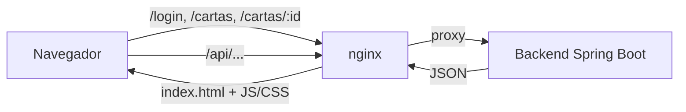

# Padrão Arquitetural: SPA (Single Page Application)

## O que é

Uma **SPA** é uma aplicação web que carrega **uma única página HTML**. A partir daí, a navegação
acontece no próprio navegador, via JavaScript, **sem recarregar a página**: o roteador do cliente
troca os componentes na tela e atualiza a URL. Os dados vêm do backend por chamadas HTTP
assíncronas em JSON.

Assim, o **servidor só fornece dados** (API REST) e o **cliente cuida da interface**.

## Como foi implementado no código

O front-end (`frontend/`) usa **React + TypeScript + Vite**, com **React Router** para as rotas.

| Parte | Onde | O que faz |
| --- | --- | --- |
| Página única | `index.html` | Contém só `
`, onde o React monta a interface (`main.tsx`) |
| Rotas no cliente | `App.tsx` | `/login`, `/cartas` e `/cartas/:id` são componentes React, não arquivos HTML. A navegação usa `<Link>` |
| Guarda de rota | `ProtectedRoute` (`App.tsx`) | Redireciona para `/login` quem não está autenticado |
| Acesso à API | `api/client.ts` | `POST /api/autenticacao/login`, `GET /api/cartas?usuarioId=` e `GET /api/cartas/{id}` |
| Requisições | `hooks/useRequest.ts` | Controla os estados de carregamento, sucesso e erro, cancela chamadas obsoletas e repete uma vez em erros de rede ou 5xx |
| Estado no cliente | `auth/AuthContext.tsx` e `pages/CardsPage.tsx` | Sessão no `localStorage`. Busca, filtros e ordenação são aplicados no navegador e guardados na URL |
| Entrega | `nginx.conf` | Serve o build, encaminha `/api` para o backend e devolve o `index.html` em qualquer rota (`try_files`) |

## Qual o benefício que trouxe

- **Navegação rápida:** trocar de tela não recarrega a página nem baixa de novo JS, CSS e fontes.
- **Filtros instantâneos:** busca, filtro por tipo e ordenação rodam no navegador, sem esperar o
  servidor.
- **URLs compartilháveis:** a URL reflete a tela e os filtros, e os botões voltar/avançar
  funcionam normalmente.
- **Front-end e back-end independentes:** o backend só expõe JSON, então os dois lados evoluem e
  são implantados separadamente (containers distintos no `docker-compose.yml`), desde que o
  contrato da API (`api/types.ts`) seja mantido.
- **API reutilizável:** outros clientes, como um app mobile, podem usar a mesma API.

**Limitações:**
- o primeiro carregamento é maior;
- o SEO é limitado, o que não afeta o projeto, porque a aplicação exige login;
- o servidor precisa do fallback para `index.html`;
- o `ProtectedRoute` só controla a navegação; a proteção real dos dados deve ficar no backend.
