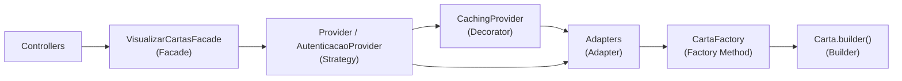

# Padrões de Projeto do Backend

O backend do **Visualizar Cartas** (`visualizar_cartas/`, Java 25 + Spring Boot) usa seis padrões
de projeto. O diagrama mostra o fluxo de uma requisição:



---

## Facade

**O que é:** oferece uma interface única e simples para um conjunto de classes mais complexo.

**Como foi implementado:** a `facade/VisualizarCartasFacade` concentra os três casos de uso
(`iniciarSessao`, `listarCartas` e `detalharCarta`) e coordena a `Autenticacao` e os providers.
Os controllers dependem só dela:

```java
@GetMapping("/{id}")
public Carta detalharCartas(@PathVariable int id) throws IOException, InterruptedException {
    return facade.detalharCarta(id);
}
```

**Benefício:**
- Os controllers só tratam o HTTP. Regras como a ordenação por nome ficam na fachada.
- Mudanças em adapters, cache ou autenticação não afetam os controllers.
- Os casos de uso podem ser testados sem servidor HTTP (`VisualizarCartasFacadeTest`).

---

## Decorator

**O que é:** acrescenta comportamento a um objeto sem alterar a classe dele, envolvendo-o com
outro objeto que tem a mesma interface.

**Como foi implementado:** o `cache/CachingProvider<T, K>` implementa `Provider<T, K>`, guarda o
provider original (`delegate`) e só chama esse provider quando a chave não está em cache. A
`config/ProvidersConfig` faz a montagem:

```java
return new CachingProvider<>(new PokeApiGitAdapter(baseUrl));   // profile mock
return new CachingProvider<>(new PokeAPIAdapter());             // profile real
```

**Benefício:**
- **Desempenho:** em teste local, `GET /api/cartas/25` caiu de 1,44 s para 44 ms na segunda
  chamada.
- Os adapters ficaram só com a busca de dados. O cache é uma classe reaproveitável por qualquer
  `Provider`.
- Quem usa o provider não percebe a diferença, porque a interface é a mesma.

---

## Factory Method

**O que é:** uma classe base define o método que cria o objeto e deixa para as subclasses as
partes que variam.

**Como foi implementado:** a classe abstrata `cartas/factory/CartaFactory` monta a `Carta` em
`criar(json)`. As partes que dependem da fonte de dados são métodos abstratos:

| Subclasse | Usada por | `criarTipos` / `criarHabilidades` |
| --- | --- | --- |
| `GitCartaFactory` | `PokeApiGitAdapter` | Lê os dados embutidos no JSON |
| `PokeApiCartaFactory` | `PokeAPIAdapter` | Faz uma requisição por tipo e por habilidade |

**Benefício:**
- Acabou a duplicação entre os adapters: a extração de sprites, do id, do cry e a montagem da
  carta ficam em um só lugar.
- Uma nova fonte de dados só precisa de uma nova subclasse.
- As duas fontes geram a `Carta` sempre no mesmo formato.

---

## Builder

**O que é:** separa a construção de um objeto complexo da sua representação, permitindo montá-lo
passo a passo, com métodos nomeados, e validá-lo antes de criá-lo.

**Como foi implementado:** a `Carta` tem um construtor privado e uma classe interna
`Carta.Builder`. A `CartaFactory` monta a carta assim:

```java
return Carta.builder()
        .id(json.getInt("id"))
        .nome(json.getString("name"))
        .altura((float) json.getDouble("height"))
        .peso((float) json.getDouble("weight"))
        .tipos(criarTipos(json))
        .habilidades(criarHabilidades(json))
        .sprites(criarSprites(json))
        .build();
```

O `build()` valida a carta: ela precisa ter um nome e de 1 a 2 tipos. Os campos opcionais têm
valores padrão (`urlCry = ""` e arrays vazios no lugar de `null`).

**Benefício:**
- **Legibilidade:** cada valor aparece com o nome do campo, em vez de um construtor com 9
  parâmetros em que é fácil trocar a ordem (por exemplo, `altura` e `peso`, que são do mesmo tipo).
- **Validação centralizada:** a regra de 1 a 2 tipos, que antes ficava só na
  `PokeApiCartaFactory`, agora vale para qualquer carta criada.
- **Sem `null`:** campos não informados recebem valores padrão seguros.

---

## Adapter

**O que é:** converte a interface de um sistema externo para a interface que a aplicação espera.

**Como foi implementado:** a aplicação define as interfaces `Provider<T, K>` e
`AutenticacaoProvider` em `interfaces/`. As classes em `adapters/` traduzem cada fonte externa:

| Adapter | Fonte | Converte para |
| --- | --- | --- |
| `PokeAPIAdapter` | PokéAPI (`pokeapi.co`) | `Carta` |
| `PokeApiGitAdapter` | Espelho da PokéAPI no GitHub | `Carta` |
| `MockDistribuicaoAdapter` / `DistribuicaoAdapter` | `distribuicao.json` / serviço de distribuição | `List<Carta>` |
| `MockJogadoresAdapter` / `JogadoresAdapter` | `usuarios.json` / serviço de Jogadores | `Optional<User>` |

**Benefício:**
- Os detalhes de URLs, formatos de JSON e códigos HTTP ficam isolados nos adapters.
- A fonte de dados pode ser trocada sem mexer na fachada nem nos controllers.
- Os mocks permitiram desenvolver a aplicação antes de os serviços externos existirem.

---

## Strategy

**O que é:** define implementações intercambiáveis de um mesmo comportamento, todas com a mesma
interface. O cliente não sabe qual delas está sendo usada.

**Como foi implementado:**
- **Por profile do Spring:** cada interface tem uma implementação para `mock` (padrão) e outra
  para `real`, escolhida na inicialização com `@Profile` ou pela `ProvidersConfig`:

  | Interface | `mock` | `real` |
  | --- | --- | --- |
  | `AutenticacaoProvider` | `MockJogadoresAdapter` | `JogadoresAdapter` |
  | `Provider<List<Carta>, Integer>` | `MockDistribuicaoAdapter` | `DistribuicaoAdapter` |
  | `Provider<Carta, String>` | `PokeApiGitAdapter` (com cache) | `PokeAPIAdapter` (com cache) |

- **Na busca de JSON:** a `PokeApiCartaFactory` recebe a estratégia de busca pela interface
  `JsonFetcher` (`new PokeApiCartaFactory(this::buscarJson)`).

**Benefício:**
- O mesmo código roda com dados locais ou com os serviços reais. Basta trocar
  `SPRING_PROFILES_ACTIVE`.
- Não há `if (ambiente == ...)` espalhado pelo código.
- A factory pode ser testada com uma busca falsa, sem acessar a internet.

---

## Resumo

| Padrão | Categoria | Onde está |
| --- | --- | --- |
| Facade | Estrutural | `facade/VisualizarCartasFacade` |
| Decorator | Estrutural | `cache/CachingProvider` + `config/ProvidersConfig` |
| Adapter | Estrutural | `adapters/` + `interfaces/` |
| Factory Method | Criação | `cartas/factory/` |
| Builder | Criação | `cartas/Carta.Builder` |
| Strategy | Comportamental | Profiles `mock`/`real` e `JsonFetcher` |
